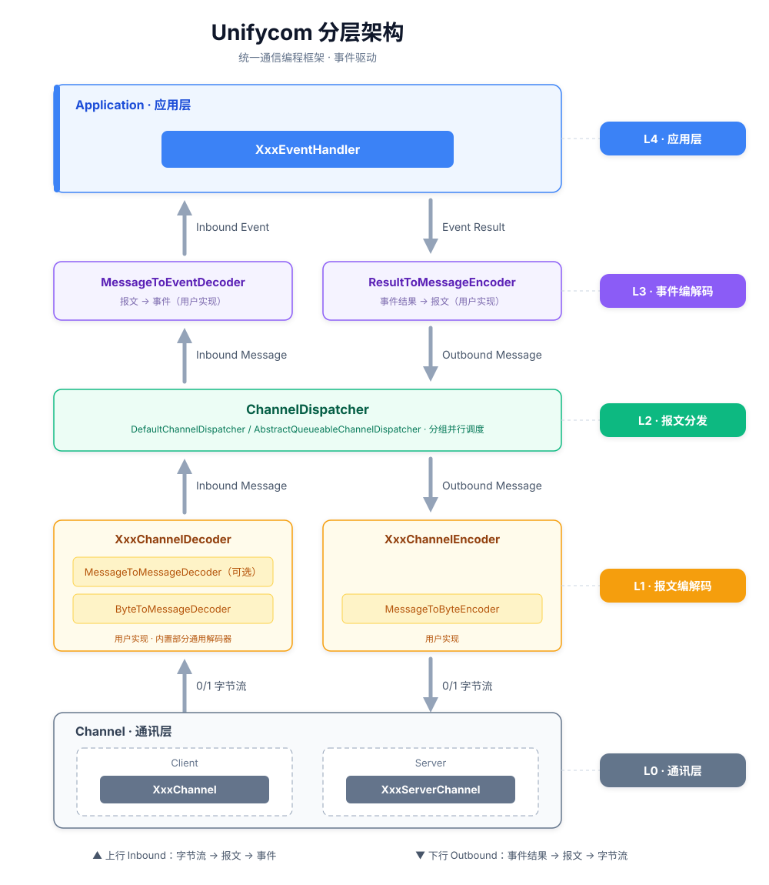
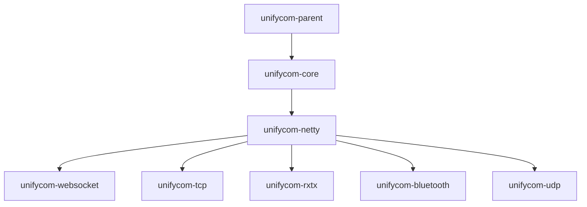

# Unifycom


**Unifycom** 是一个统一通信编程框架，旨在屏蔽 TCP、UDP、蓝牙、串口等异构通道的底层差异，为客户端与服务端提供一致的编程界面。框架将通信报文与连接状态转换为事件驱动模型，开发者只需专注于报文编解码与业务事件处理，无需再操心连接管理、重连、心跳等通信细节。

## 特性

- **统一通道抽象** — 根据连接串即可创建 TCP、UDP、串口、蓝牙、WebSocket 的客户端或服务端；
- **断线自动重连** — 客户端断线后自动重连，重连周期可配置（默认 5 秒）；
- **空闲心跳维持** — 支持客户端通道空闲心跳（默认 5 秒），保障长连接可用性；
- **状态事件化** — 通道建立、断开、空闲等状态均可转换为事件处理；
- **注解驱动事件** — 扫描注解将报文解码为事件，处理结果通过注解编码回报文；
- **报文分组并行处理** — 按自定义规则对报文分组，同组报文保序、不同组并行，提升吞吐率；
- **Proxy Protocol v2** — 内置 TCP 代理协议 v2 解码器，可穿透代理获取客户端真实 IP；
- **事件拦截器** — 支持事件级拦截器（`Interceptor`）与全局事件拦截器，便于扩展横切逻辑。

## 架构



框架采用分层架构，自下而上共五层：

| 层级 | 名称 | 说明 |
|:---:|------|------|
| **L4** | 应用层 | 用户实现 `EventHandler` 处理事件，处理完毕后返回 `EventResult` |
| **L3** | 事件编解码层 | 将报文对象解码为事件对象，或将事件处理结果编码为报文对象，需用户实现 |
| **L2** | 报文分发层 | `ChannelDispatcher` 将事件路由至对应处理器，支持报文分组并行调度 |
| **L1** | 报文编解码层 | 在字节流与报文对象之间相互转换，框架内置部分通用编解码器，亦可自定义 |
| **L0** | 通讯层 | 已实现 TCP 客户端/服务端、UDP、串口、蓝牙等通道 |

## 工程架构



| 模块 | 功能 |
|------|------|
| `unifycom-parent` | 父 POM，统一管理模块、依赖与版本 |
| `unifycom-core` | 框架核心，封装 Channel 基础接口、事件、拦截器与分发器 |
| `unifycom-netty` | 基于 Netty Channel 的封装（断线重连等），供基于 Netty 的子模块复用 |
| `unifycom-tcp` | 基于 Netty 的 TCP 通道，已实现客户端与服务端 |
| `unifycom-udp` | 基于 Netty 的 UDP 通道，已实现客户端与服务端 |
| `unifycom-rxtx` | 基于 Netty 的串口通道 |
| `unifycom-bluetooth` | 基于 Netty 的蓝牙通道，已实现客户端 |
| `unifycom-websocket` | 基于 Undertow 的 WebSocket 通道，已实现客户端与服务端 |

## 快速开始

以 TCP 为例，创建**客户端**：

```java
TcpChannel channel = new TcpChannel(
        new TcpChannelConfig("localhost:8080"), decoder, encoder, dispatcher);

channel.addLast(new GreetingEventHandler(), new ConnectedEventHandler(),
        new DisconnectedEventHandler(), new IdleEventHandler());

channel.connect().blockUntilConnected();
```

创建**服务端**：

```java
TcpServerChannel channel = new TcpServerChannel(
        new TcpServerChannelConfig("8080"), decoder, encoder, dispatcher);

channel.addLast(new GreetingEventHandler(), new ConnectedEventHandler(),
        new DisconnectedEventHandler(), new IdleEventHandler());

channel.startup();
```

两者 API 几乎一致，仅有两处区别：

1. 客户端创建 `TcpChannel`，服务端创建 `TcpServerChannel`；
2. 客户端调用 `connect()` 建立连接，服务端调用 `startup()` 开始监听。

> 更多用法（UDP、蓝牙、串口、WebSocket、二进制帧、拦截器等）见 [example](example/) 目录。

## 路线图

- [x] 完善 TCP 与串口通道，新增串口服务器；
- [x] 新增蓝牙、UDP、WebSocket 通道；
- [ ] 补充文档与更多 example；
- [ ] 通道实现持续扩展与打磨。

## 常见问题

**协议帧已解码为 `Message` 对象，为什么不直接暴露给 Handler，而要转换为 `Event`？**

> 这是项目分层设计的考量：
>
> `Message` 处于协议层，是对协议报文的完整翻译，需要 100% 还原报文内容。出于协议设计需要，报文中包含大量非业务字段，例如报文头中的 ID、序号、版本号、校验符等。
>
> 而 Handler 处于业务层，并不关心协议版本、报文 ID 等非业务字段。因此需要将业务相关字段从 `Message` 传递到 `Event` 对象，让 Handler 只面对纯业务信息，实现协议与业务的解耦。
